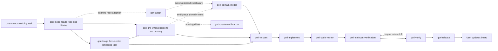

# gori-skills

One entry point for a user-selected product task. `gori-mode` reads the repository's existing issue, board Status, context and gates, then loads only the phase skills needed. It combines adapted [Matt Pocock engineering skills](https://github.com/mattpocock/skills) with [Lauren Tan's executable verification approach](https://github.com/backnotprop/pstack). These are Gori adaptations, not upstream releases. [Third-party notices](THIRD_PARTY_NOTICES.md) preserve attribution.

## The route



Skip a phase when its work is already evidenced; record why. `Inbox` routes through triage of the selected card, then only the missing decisions and spec work. Before every selected task ships, Gori compares the affected feature-map entries and verification driver with final source, updates them when needed, and drives the affected journey. A failed review or verification returns to implementation and repeats affected checks. The user owns task selection, issue creation and Project card changes. Gori may recommend a status change but never makes it.

For a board with `Inbox`, `Needs Grill`, `In Progress`, `In Review` and `Done`, `gori-mode` maps those Status values to the route above. A separate Phase field may identify product areas rather than workflow state. Other repositories can use different Status values. Gori reads each repo's actual board and canonical context instead of imposing columns or a new queue.

| Skill | Phase or trigger |
| --- | --- |
| `gori-mode` | Single router for the selected task |
| `gori-adopt` | One-time existing-repo setup and contract check |
| `gori-triage` | Check the selected untriaged issue or PR against source and route it |
| `gori-grill` | Resolve missing decisions, commonly `Needs Grill` |
| `gori-domain-model` | Settle consequential domain terms in the repo's existing context |
| `gori-to-spec` | Record settled outcomes and proof in the existing issue or context |
| `gori-implement` | Build vertical slices, commonly `In Progress` |
| `gori-code-review` | Review intent and code separately, commonly `In Review` |
| `gori-create-verification` | Add a real user-path driver only when absent |
| `gori-verify` | Run focused checks and the affected real journey |
| `gori-maintain-verification` | Reconcile affected map and harness before release; full audit only when requested |
| `gori-release` | Follow the repo's authorized PR, CI and production gates |

`gtm` and `vercel-resend-default` are optional, unrelated skills. Matt's separate plugin is not required for the Gori route. Gori does not copy every specialist Matt or pstack skill.

## Enter an existing project

Run `gori-adopt` once to inventory the repo's own task authority, vocabulary, feature map, executable verification and release gates. An absent glossary is fine when the canonical context already explains the terms; add a small glossary only if shared ambiguity affects behavior. If the feature map is absent, seed three to five source-grounded critical user paths in the existing docs location. If a real user-path driver is absent, create the smallest runnable one and prove one mapped journey. Repair existing maps or scripts only for demonstrated drift. This setup does not triage the backlog.

When you select an existing untriaged card, `gori-triage` checks its claim and current source, then routes genuine decisions to `gori-grill` and missing acceptance to `gori-to-spec`. An `In Progress` card with no usable spec still needs that spec. The issue and repo rules determine what Codex can edit; Project cards remain read-only. Each T3 thread needs an explicitly selected worktree if you want isolation; a new thread does not create one automatically.

## Install into one product repo

Clone once. Python 3 and Git are the only installer requirements.

```sh
git clone https://github.com/peregori/gori-skills.git ~/gori-skills
python3 ~/gori-skills/scripts/install.py /absolute/path/to/product
python3 ~/gori-skills/scripts/install.py /absolute/path/to/product --apply
```

The first installer run prints a read-only plan. The second copies the twelve core skills into `.agents/skills/`. Use `--all` before `--apply` to include the two optional skills, or name a skill. The installer includes `gori-mode`'s phase dependencies and refuses to overwrite differing product copies. Review and commit installed files in the product repo.

Add one pointer to the product's existing `AGENTS.md` when needed: “For selected product work, use `.agents/skills/gori-mode`; the repo's canonical context and release gates remain authoritative.” [Codex's skill documentation](https://learn.chatgpt.com/docs/build-skills) describes `.agents/skills/` as a repository location. A same-named global copy may also appear in the selector. Installing snapshots does not create a second backlog or replace product scripts.

The earlier `factory-workflow`, `matt-engineering` and `product-verification` directories are superseded. The installer does not delete them from repositories that adopted the first release. Reconcile local edits and remove those directories and their old pointer before using `gori-mode` there.

## Verify this package

```sh
python3 -m unittest discover -s tests -v
```

The tests cover read-only planning, dependency selection, repeat installation, conflict protection and catalog links. Validate changed manifests with Codex's `skill-creator` validator when available. Inspect the full public diff for machine paths, product data and secrets before publishing. Runtime routing remains a product-level claim until a selected task exercises the phases against its repo and board.
